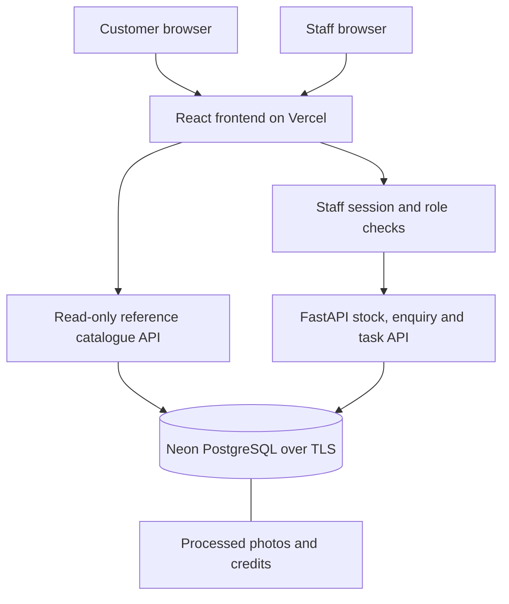

# Dealer Desk

By [Mohammed Sheikh-Noor](https://github.com/mohanoor-ai).

Dealer Desk is a web application for one car dealership. It keeps vehicle availability, customer enquiries and follow-up tasks in a shared workspace, so staff can see which enquiry needs a next action and avoid conflicting stock edits.

[Public website](https://dealer-desk-prod.vercel.app/) · [Source code](https://github.com/mohanoor-ai/dealer-desk) · [Task tracker](https://github.com/mohanoor-ai/dealer-desk/issues)

[Problem](#problem-description) · [Specification](#product-specification) · [Technology](#technology-and-deployment) · [Workflow](#workflow-in-practice) · [Setup](#run-locally) · [Tests](#tests-and-verification) · [Operations](#observability-and-incident-response) · [Project evidence](#project-evidence) · [Issues](#issue-tracker)

## Problem description

### The problem

When vehicle stock, customer enquiries and follow-up tasks are kept in separate lists, staff cannot easily see what a customer asked, which vehicle it concerns or what should happen next. Shared stock edits also need protection against one person overwriting another person's update.

### System functionality

**Customer website:** visitors browse reference listings, search and filter vehicles, switch thumbnail/list views and open vehicle details with credited photographs. Browsing does not require a staff account. Website enquiry delivery is not yet connected.

**Staff/dealer workspace:** individual accounts provide access to stock management, photos, enquiries and follow-ups. Staff records a request against a vehicle, opens the enquiry directly, schedules the next action and completes or reopens the task. The overview identifies enquiries without a next action and shows scheduled work with its due date. Viewer accounts are read-only; sales staff can manage records; managers can also inspect audit history.

### Expected system behaviour

- Saved staff records survive page reloads and application restarts.
- The enquiry count opens the open-enquiry list; an enquiry number opens that exact record.
- An open enquiry without an incomplete task is labelled No next action scheduled.
- Scheduling from an enquiry selects the correct record. Completing a task does not close the enquiry or send a customer reply.
- Backend validation and role checks reject invalid or unauthorized changes. A stale edit returns a conflict instead of overwriting newer data.
- The public catalogue excludes customer records and internal notes. Optional browser demos reset their per-tab memory without writing to the staff database.

Reference prices and photographs are illustrative, not offers for sale. Email, WhatsApp and SMS are not connected.

## Product specification

The implemented scope is one dealership with a read-only customer catalogue and an authenticated staff workspace. Core technical acceptance criteria are:

| Area | Expected result |
|---|---|
| Validation and access | Invalid input is rejected; private reads and writes require the appropriate staff access |
| Stock and persistence | Vehicle, enquiry and task relationships remain saved after reload/restart |
| Concurrent edits | A stale revision returns HTTP 409 and preserves the newer record |
| Enquiry workflow | Direct record links, correct scheduling context and explicit missing next actions |
| Photos | File/type/dimension limits, metadata removal, persistence, cover selection and attribution |
| Delivery | Successful exact-revision CI before deployment; explicit production promotion and verified compatible recovery |
| Operations | Collected/correlated request signals, a user-impact alert and a bounded response with recovery checks |

Tasks move from acceptance criteria through implementation, verification and release. Mohammed Sheikh-Noor defines scope and reviews behaviour; the coding assistant implements changes, runs checks and records results. Engineering and verification were performed within one assistant workflow.

Supporting specifications and records:

- [Product specification and technical acceptance criteria](product-spec.md).
- [Public task tracker](https://github.com/mohanoor-ai/dealer-desk/issues) and [task record](docs/tasks.md).
- [Agent responsibilities](docs/team.md), [execution process](docs/process.md), [project instructions](AGENTS.md) and [AI-use record](docs/ai-use.md).
- [Issue-to-implementation traceability](docs/issue-traceability.md): issue #5, its acceptance criteria, changes, tests, screenshots, CI and release.
- [API contract](openapi.yaml).
- [Testing instructions](docs/testing.md) and [verification record](docs/verification.md).
- [Assessment evidence index](docs/assessment-evidence.md).

## Technology and deployment

| Area | Implementation |
|---|---|
| Frontend | React, TypeScript, Vite |
| Backend and API validation | Python, FastAPI, Pydantic; committed OpenAPI contract |
| Persistence | SQLAlchemy, Alembic; SQLite locally or PostgreSQL |
| Hosting | Vercel application/frontend; Neon PostgreSQL |
| Staff access | Individual accounts, hashed passwords, expiring server sessions, backend role checks |
| Images | Pillow processing; bounded image/thumbnail bytes stored in the database |
| Tests | pytest; Vitest and React Testing Library; separate PostgreSQL/container/browser checks |
| Containers and delivery | Docker Compose; GitHub Actions; exact-revision CI gate; manual production promotion |
| Local operations | OpenTelemetry, OTLP HTTP/protobuf, custom loopback SQLite collector and correlation UI |
| Agent extensions | Read-only MCP stdio tool, reusable verification procedure, specialist definition and enforced response policy |

| Environment | URL | Access |
|---|---|---|
| Production | https://dealer-desk-prod.vercel.app/ | Public browsing; individual app login for staff records |
| Development | https://dealer-desk-dev.vercel.app/ | Vercel authorization, then staff app login |
| Local | Address printed by the startup command | Loopback access; locally created staff account |

Production and development use separate Neon branch endpoints. Production tracks `production-release`, advanced explicitly after successful main CI. Preview protection remains enabled. See [environments](docs/environments.md) and [release/recovery](docs/release-recovery.md).

## Workflow in practice


Actual staff UI captured 25 October 2026 from application code [0b1aff9](https://github.com/mohanoor-ai/dealer-desk/commit/0b1aff92713137a20f8007f212068c347cb4dd6d), using a copied local database and demonstration records. Ten vehicles, two open enquiries and zero pending follow-ups are shown. [Capture details and photo credits](docs/media/README.md).


Alex asks whether the Ford Puma is available to view. Staff opens enquiry #2, schedules an availability check and completes that internal task. The enquiry remains open and returns to “No next action scheduled” until staff decides the next step. These are saved API/database operations, not the browser-memory demo. No customer reply was sent. [Workflow evidence](docs/verification.md).

## Architecture



Business records and images use PostgreSQL in the hosted app; local development can use SQLite. Public catalogue responses exclude customer records, internal notes and staff audit data. Browser-memory demos are separate from this flow. [Architecture](docs/architecture.md) · [Page structure](docs/site-map.md) · [Editable diagrams](docs/diagrams.md).

## Run locally

### Docker Compose

Install Docker Desktop with Linux containers on Windows, or Docker Engine with Compose on Linux. Initial image/dependency downloads require internet. From a checkout:

```powershell
# Windows PowerShell
./start.ps1
```

```sh
# Linux
sh start.sh
```

The startup script preserves an existing `.env` and database volume, builds/starts the app and PostgreSQL, and prompts for the first manager account if none exists. Passwords are entered interactively. Open the address printed by the script. Do not remove a volume containing records you need.

Create another account:

```sh
docker compose exec app python -m scripts.create_user alex --role sales
```

Available roles: viewer, sales, manager. No shared password ships with the app.

### Python and Node.js

Install Python 3.12+, uv and Node.js 24:

```sh
uv sync --frozen
npm ci --prefix frontend
npm run build --prefix frontend
uv run alembic upgrade head
uv run python -m scripts.create_user manager --role manager
uv run python start.py
```

The default local database is `data/dealer-v2.sqlite3`. Configure `DATABASE_URL` privately for PostgreSQL. Migrations run explicitly, not during a web request or Vercel build. For frontend development, run `npm run dev` inside `frontend`; its API proxy targets port 8090.

## Tests and verification

```sh
uv run python -m scripts.verify
```

After dependency setup, this command runs backend tests, frontend tests, the production build and the limited source/history audit, stopping at the first failure. PostgreSQL, clean Compose, replacement/rollback and local operations labs run as additional CI stages.

The verified application revision [14f075b](https://github.com/mohanoor-ai/dealer-desk/commit/14f075b938b1cc4a3812edaea87c6d12d7b7f6b7) passed 38 backend and 14 frontend tests plus all additional stages in [CI run 40215259023](https://github.com/mohanoor-ai/dealer-desk/actions/runs/40215259023). Production health matched that revision. Documentation-only revisions can follow it; their own checks remain visible in Actions.

[Testing commands](docs/testing.md) explain each layer. [Verification](docs/verification.md) retains actual observations and limits. Browser captures/manual checks are not an automated cross-engine suite. The local Docker engine was unavailable during the final checks; hosted CI demonstrated the clean Compose journey and recovery.

## Observability and incident response

- Request metrics, structured logs and traces.
- Signal collection, storage and a correlation dashboard.
- Stock-read failure alert.
- Bounded incident response and recovery verification.
- Backup and restore checks.

[View operations and incident-response details →](docs/operations.md)

## Project evidence

### Problem Description

The [problem description](#problem-description) explains the dealership problem, customer/staff functionality and expected behaviour.

### Product Specification

The [specification](product-spec.md) defines scope and numbered acceptance criteria. The [public tracker](https://github.com/mohanoor-ai/dealer-desk/issues) and [issue #5 example](docs/issue-traceability.md) connect those criteria to actual execution.

### Agent Team Specification

[Responsibilities](docs/team.md) and the [execution process](docs/process.md) identify the owner and coding assistant's roles. Engineering and verification were performed within one assistant workflow; independent specialist execution is not claimed.

### Context Management

[AGENTS.md](AGENTS.md) directs work through modular specification, architecture, process, testing and security documents. The [AI-use record](docs/ai-use.md) describes actual assistance and corrections.

### Application

The [public website](https://dealer-desk-prod.vercel.app/) provides vehicle browsing. Authenticated staff pages connect stock, enquiries and follow-ups to persistent storage. [Workflow captures](#workflow-in-practice) and [local setup](#run-locally) show how to inspect it.

### Testing

One [verification command](#tests-and-verification) runs backend/frontend tests, build and the limited source audit. The verified application revision passed 38 backend and 14 frontend tests; [CI](https://github.com/mohanoor-ai/dealer-desk/actions/runs/40215259023) adds PostgreSQL, container and recovery checks.

### Containerization

[Docker Compose](docker-compose.yml) runs the application and PostgreSQL. The [startup commands](#run-locally) provision local access, and CI verifies clean startup and record persistence after app replacement. The local Docker engine limitation is recorded in [verification](docs/verification.md).

### Deployment

[Vercel and Neon](docs/environments.md) host separate development/production environments. Production browsing is public; staff records require app login. [Deployment verification](docs/verification.md) retains observed revisions and access checks.

### CI/CD

[GitHub Actions](.github/workflows/ci.yml) checks main pushes and pull requests. An exact-revision gate controls development builds; production promotion is explicit. [Release/recovery evidence](docs/release-recovery.md) records compatible rollback and forward restoration.

### Observability

OpenTelemetry request metrics, traces and structured logs are collected, stored and correlated in a custom local UI. [Operations details](docs/operations.md) describe the signal boundaries; Grafana/LGTM and managed production monitoring are not deployed.

### Alerting on User Impact

Three failed authenticated stock reads trigger StockReadUnavailable in the isolated rehearsal. The [incident report](docs/evidence/incident-rehearsal.json) records the failures, response and recovery.

### On-Call Agent

An alert invokes a deterministic policy responder that repairs only the known local fault and rechecks the same request. [Implementation and limits](docs/operations.md) describe the guardrails; LLM diagnosis and autonomous production repair are not implemented.

## Issue tracker

Status checked 25 October 2026. Open/closed is the tracker state; the scope column distinguishes completed work from deferred or partial implementation.

| Issue | Tracker state | Scope |
|---|---|---|
| [#1 — Deploy a protected Vercel development version with Neon](https://github.com/mohanoor-ai/dealer-desk/issues/1) | Closed | Completed and verified |
| [#2 — Add Cloudflare R2 photo storage with verified access boundaries](https://github.com/mohanoor-ai/dealer-desk/issues/2) | Open | Deferred; photos remain database-backed |
| [#3 — Connect public showroom and isolated demo access to dealer workflows](https://github.com/mohanoor-ai/dealer-desk/issues/3) | Open | Browsing/demo separation implemented; live enquiry delivery and remaining controls deferred |
| [#4 — Complete assessment delivery and operational evidence](https://github.com/mohanoor-ai/dealer-desk/issues/4) | Closed | Delivery and local operations demonstrated with documented limits |
| [#5 — Make open enquiries actionable from the staff overview](https://github.com/mohanoor-ai/dealer-desk/issues/5) | Closed | Direct navigation, missing next actions and scheduling verified |

[View all issues →](https://github.com/mohanoor-ai/dealer-desk/issues?q=is%3Aissue)

## Current limits and deferred work

Live website enquiries, conversation/reply history, staff assignment, bulk upload, R2 migration, messaging integrations and an in-app LLM are deferred. Archive/restore and manager audit endpoints exist, but dedicated interface controls remain incomplete. The login limiter is process-local; a public-write service requires a separate abuse-control review.

Only demonstration data is used here. Keep credentials, `.env`, databases, backups and exports outside Git. Private learning notes and raw lesson transcripts are separate local deliverables. This personal hosted project is not a claim of readiness for real customer operations. [Security boundaries](docs/security.md).

## Learning in public

[Building Dealer Desk](docs/articles/01-building-dealer-desk.md) · [From the browser to saved records](docs/articles/02-browser-to-saved-records.md) · [Testing release and recovery](docs/articles/03-testing-release-and-recovery.md).

These technical articles describe actual decisions and checks, with AI assistance disclosed. The [article index](docs/articles/README.md) collects them. Private notes and transcripts are not part of the public app.
