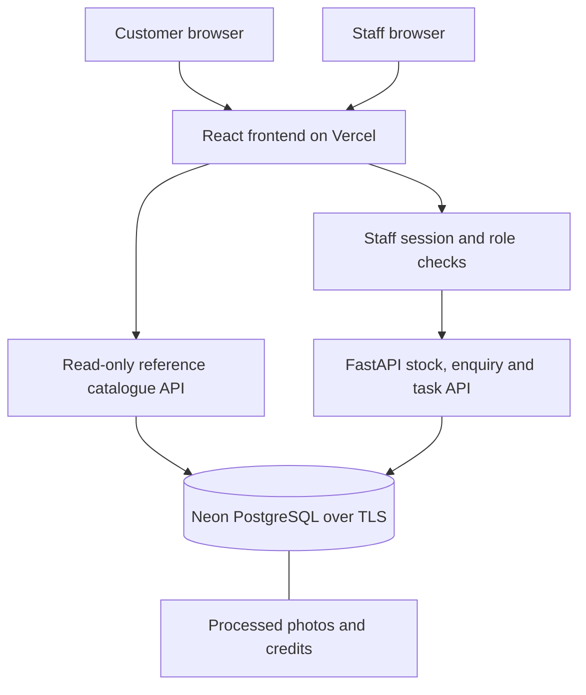

# Dealer Desk

By [Mohammed Sheikh-Noor](https://github.com/mohanoor-ai).

Dealer Desk is a web application for one car dealership. It keeps vehicle availability, customer enquiries and follow-up tasks in a shared workspace, so staff can see which enquiry needs a next action and avoid conflicting stock edits.

[Public website](https://dealer-desk-prod.vercel.app/) · [Source code](https://github.com/mohanoor-ai/dealer-desk) · [Task tracker](https://github.com/mohanoor-ai/dealer-desk/issues)

## Problem and expected behaviour

A stock list does not show what a customer asked, whether somebody checked the vehicle, or what should happen next. Dealer Desk connects those records:

- Visitors browse reference vehicle listings, search/filter stock and open vehicle details with photograph credits.
- Staff sign in, add or edit vehicles, record enquiries and schedule follow-ups against the correct enquiry.
- The overview identifies open enquiries without a next action and shows scheduled work with its due date.
- Clicking the enquiry count opens the open-enquiry list. Clicking an enquiry number opens that record.
- Completing a task leaves the enquiry open until staff closes it. An open enquiry with no remaining task is shown as unscheduled.
- Saved records survive reload/restart. A stale vehicle edit returns a conflict rather than overwriting another staff member's change.

The public catalogue uses demonstration listings and historical reference prices, not offers for sale. Website enquiry delivery and email/WhatsApp/SMS integrations are not connected. Optional browser demos reset their per-tab memory and do not write to the staff database.

## Technology and deployment

| Area | Implementation |
|---|---|
| Frontend | React, TypeScript, Vite |
| Backend and API validation | Python, FastAPI, Pydantic; committed OpenAPI contract |
| Persistence | SQLAlchemy, Alembic; SQLite locally or PostgreSQL |
| Hosting | Vercel application/frontend; Neon PostgreSQL |
| Staff access | Individual accounts, hashed passwords, expiring server sessions, backend role checks |
| Images | Pillow processing; bounded image/thumbnail bytes stored in the database |
| Tests | pytest; Vitest and React Testing Library; separate PostgreSQL/container/browser checks |
| Containers and delivery | Docker Compose; GitHub Actions; exact-revision CI gate; manual production promotion |
| Local operations | OpenTelemetry, OTLP HTTP/protobuf, custom loopback SQLite collector and correlation UI |
| Agent extensions | Read-only MCP stdio tool, reusable verification procedure, specialist definition and enforced response policy |

| Environment | URL | Access |
|---|---|---|
| Production | https://dealer-desk-prod.vercel.app/ | Public browsing; individual app login for staff records |
| Development | https://dealer-desk-dev.vercel.app/ | Vercel authorization, then staff app login |
| Local | Address printed by the startup command | Loopback access; locally created staff account |

Production and development use separate Neon branch endpoints. Production tracks `production-release`, advanced explicitly after successful main CI. Preview protection remains enabled. See [environments](docs/environments.md) and [release/recovery](docs/release-recovery.md).

## Application screenshots


Actual staff UI captured 25 October 2026 from application code [0b1aff9](https://github.com/mohanoor-ai/dealer-desk/commit/0b1aff92713137a20f8007f212068c347cb4dd6d), using a copied local database and demonstration records. Ten vehicles, two open enquiries and zero pending follow-ups are shown. [Capture details and photo credits](docs/media/README.md).


Alex asks whether the Ford Puma is available to view. Staff opens enquiry #2, schedules an availability check and completes that internal task. The enquiry remains open and returns to “No next action scheduled” until staff decides the next step. These are saved API/database operations, not the browser-memory demo. No customer reply was sent. [Workflow evidence](docs/verification.md).

## Architecture



Business records and images use PostgreSQL in the hosted app; local development can use SQLite. Public catalogue responses exclude customer records, internal notes and staff audit data. Browser-memory demos are separate from this flow. [Architecture](docs/architecture.md) · [Page structure](docs/site-map.md) · [Editable diagrams](docs/diagrams.md).

## Run locally

### Docker Compose

Install Docker Desktop with Linux containers on Windows, or Docker Engine with Compose on Linux. Initial image/dependency downloads require internet. From a checkout:

```powershell
# Windows PowerShell
./start.ps1
```

```sh
# Linux
sh start.sh
```

The startup script preserves an existing `.env` and database volume, builds/starts the app and PostgreSQL, and prompts for the first manager account if none exists. Passwords are entered interactively. Open the address printed by the script. Do not remove a volume containing records you need.

Create another account:

```sh
docker compose exec app python -m scripts.create_user alex --role sales
```

Available roles: viewer, sales, manager. No shared password ships with the app.

### Python and Node.js

Install Python 3.12+, uv and Node.js 24:

```sh
uv sync --frozen
npm ci --prefix frontend
npm run build --prefix frontend
uv run alembic upgrade head
uv run python -m scripts.create_user manager --role manager
uv run python start.py
```

The default local database is `data/dealer-v2.sqlite3`. Configure `DATABASE_URL` privately for PostgreSQL. Migrations run explicitly, not during a web request or Vercel build. For frontend development, run `npm run dev` inside `frontend`; its API proxy targets port 8090.

## Tests and verification

```sh
uv run python -m scripts.verify
```

After dependency setup, this command runs backend tests, frontend tests, the production build and the limited source/history audit, stopping at the first failure. PostgreSQL, clean Compose, replacement/rollback and local operations labs run as additional CI stages.

The verified application revision [14f075b](https://github.com/mohanoor-ai/dealer-desk/commit/14f075b938b1cc4a3812edaea87c6d12d7b7f6b7) passed 38 backend and 14 frontend tests plus all additional stages in [CI run 40215259023](https://github.com/mohanoor-ai/dealer-desk/actions/runs/40215259023). Production health matched that revision. Documentation-only revisions can follow it; their own checks remain visible in Actions.

[Testing commands](docs/testing.md) explain each layer. [Verification](docs/verification.md) retains actual observations and limits. Browser captures/manual checks are not an automated cross-engine suite. The local Docker engine was unavailable during the final checks; hosted CI demonstrated the clean Compose journey and recovery.

## Observability and incident response

The local operations lab instruments authenticated stock reads with OpenTelemetry metrics, traces and structured logs. OTLP exports are collected and stored in a bounded loopback SQLite receiver. Its UI correlates request spans, logs and sampled metric exemplars without customer fields, request bodies or credentials.

Three failed stock reads trigger an alert. A deterministic responder checks an isolated rehearsal database and authorization marker, repairs only the known table-rename fault, then verifies the same request returns 200 and the saved record remains. Unknown conditions escalate. An independent SQLite backup/restore is tested separately.

The course teaches OpenTelemetry with Prometheus, Loki, Tempo and Grafana. This project uses a custom local receiver/storage/UI instead; those four services and a hosted monitoring platform are not deployed. The responder does not invoke an LLM. [Run the operations lab](docs/operations.md) · [Release controls](docs/release-recovery.md) · [Extension permissions](docs/permissions.md).

## Specification, task execution and assessment evidence

- [Product specification](product-spec.md): users, workflows, scope and numbered technical acceptance criteria.
- [Public issues](https://github.com/mohanoor-ai/dealer-desk/issues) and [task record](docs/tasks.md): acceptance criteria and actual completion status.
- [Worked issue traceability](docs/issue-traceability.md): issue #5 from owner report through implementation, tests, screenshots, CI and release.
- [Responsibilities](docs/team.md), [process](docs/process.md) and [AGENTS.md](AGENTS.md): context, execution and permission boundaries.
- [AI-use record](docs/ai-use.md): actual assistance, corrections and limitations; no independent review is invented.
- [Assessment evidence index](docs/assessment-evidence.md): reviewer navigation for the twelve criteria, separate from a grade claim.
- [API contract](openapi.yaml), [security](docs/security.md) and [dependency review](security/review.md): interfaces, controls and recorded findings.

## Current limits and deferred work

Live website enquiries, conversation/reply history, staff assignment, bulk upload, R2 migration, messaging integrations and an in-app LLM are deferred. Archive/restore and manager audit endpoints exist, but dedicated interface controls remain incomplete. The login limiter is process-local; a public-write service requires a separate abuse-control review.

Only demonstration data is used here. Keep credentials, `.env`, databases, backups and exports outside Git. Private learning notes and raw lesson transcripts are separate local deliverables. This personal hosted project is not a claim of readiness for real customer operations. [Security boundaries](docs/security.md).

## Learning in public

[Building Dealer Desk](docs/articles/01-building-dealer-desk.md) · [From the browser to saved records](docs/articles/02-browser-to-saved-records.md) · [Testing release and recovery](docs/articles/03-testing-release-and-recovery.md).

These technical articles describe actual decisions and checks, with AI assistance disclosed. The [article index](docs/articles/README.md) collects them. Private notes and transcripts are not part of the public app.
