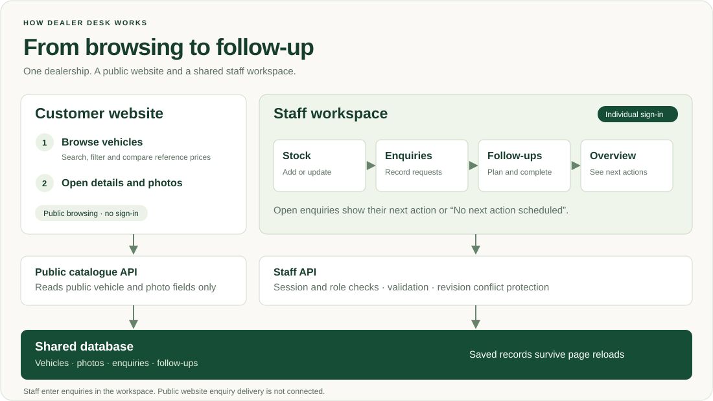
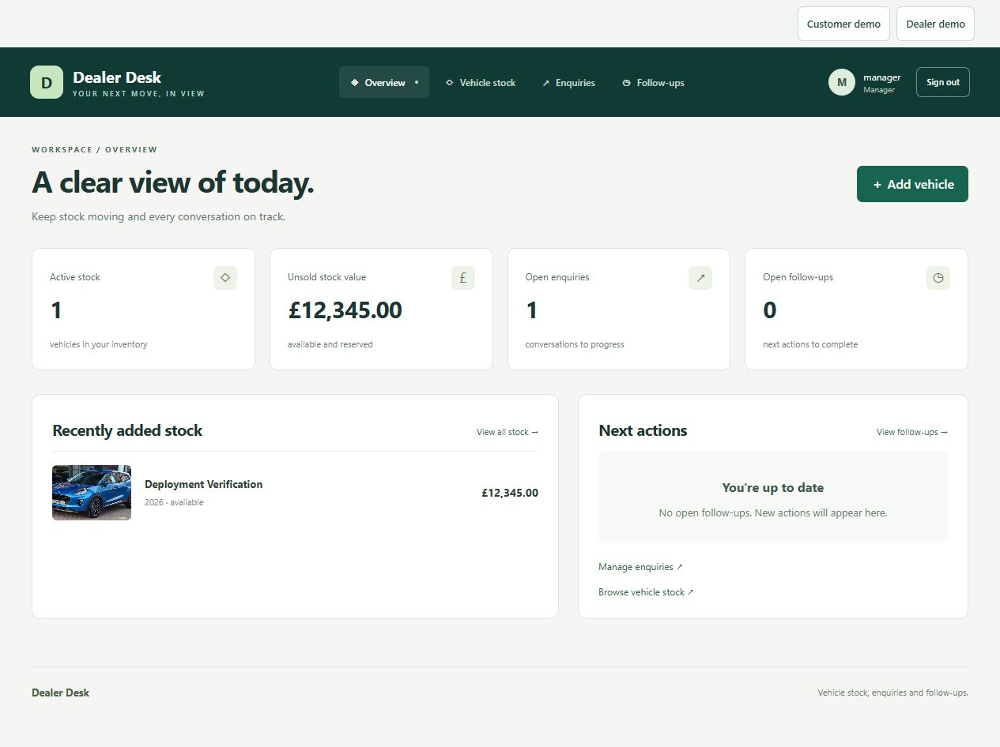
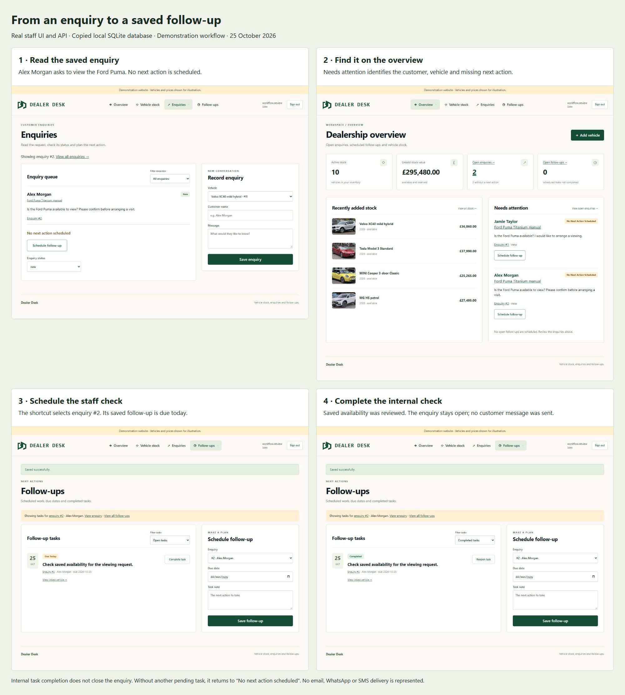
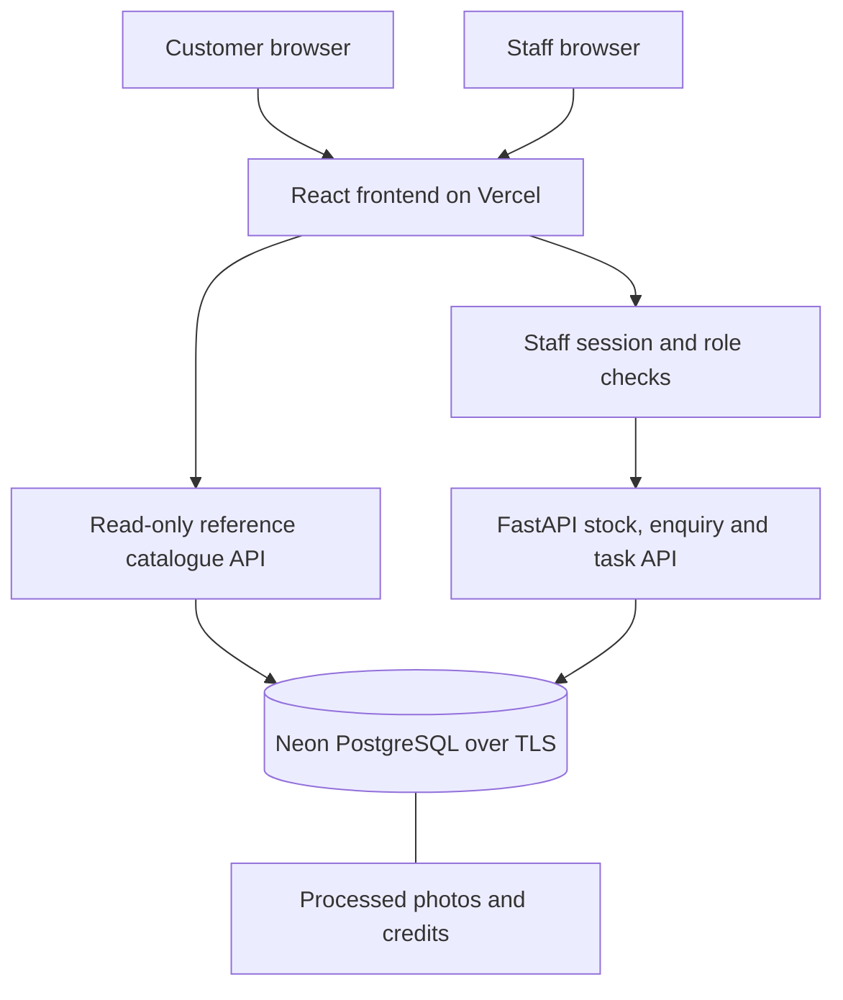

# Dealer Desk

<p align="center"></p>

<p align="center"><a href="docs/media/dealer-desk-functionality.svg"></a></p>

<sub>[Architecture details](docs/architecture.md) · [Full screenshot collage](docs/media/site-collage.jpg)</sub>

Full-size pages: [Homepage](docs/media/screenshots/landing-full.jpg) · [Catalogue](docs/media/screenshots/catalogue-full.jpg) · [Vehicle details](docs/media/screenshots/vehicle-full.jpg) · [Staff overview](docs/media/screenshots/staff-overview-full.jpg)

By [Mohammed Sheikh-Noor](https://github.com/mohanoor-ai).

Dealer Desk is a web application for one car dealership. It keeps vehicle availability, customer enquiries and follow-up tasks in a shared workspace, so staff can see which enquiry needs a next action and avoid conflicting stock edits.

[Public website](https://dealer-desk-prod.vercel.app/) · [Source code](https://github.com/mohanoor-ai/dealer-desk) · [Task tracker](https://github.com/mohanoor-ai/dealer-desk/issues)

**Running the app:** [Open the cloud deployment](https://dealer-desk-prod.vercel.app/) on [Vercel](https://vercel.com/) with [Neon PostgreSQL](https://neon.com/), or [run locally with Docker Compose](#run-locally). To recreate the hosted setup in your own accounts, follow the [cloud deployment how-to](docs/deployment-vercel.md#recreate-the-cloud-deployment).

[Problem](#problem-description) · [Specification](#product-specification) · [Technology](#technology-stack) · [Workflow](#workflow-in-practice) · [Setup](#run-locally) · [Tests](#tests-and-verification) · [Deployment](#deployment) · [Operations](#observability-and-incident-response) · [Issues](#issue-tracker)

## Problem description

### The problem

When vehicle stock, customer enquiries and follow-up tasks are kept in separate lists, staff cannot easily see what a customer asked, which vehicle it concerns or what should happen next. Shared stock edits also need protection against one person overwriting another person's update.

### System functionality

**Customer website:** visitors browse reference listings, search and filter vehicles, switch thumbnail/list views and open vehicle details with credited photographs. Browsing does not require a staff account. Website enquiry delivery is not yet connected. On phones, top and bottom menu buttons open vertical navigation; the staff menu provides the workspace destinations.

**Staff/dealer workspace:** individual accounts provide access to stock management, photos, enquiries and follow-ups. Staff records a request against a vehicle, opens the enquiry directly, schedules the next action and completes or reopens the task. The overview identifies enquiries without a next action and shows scheduled work with its due date. Viewer accounts are read-only; sales staff can manage records; managers can also inspect audit history.

### Expected system behaviour

- Saved staff records survive page reloads and application restarts.
- The enquiry count opens the open-enquiry list; an enquiry number opens that exact record.
- An open enquiry without an incomplete task is labelled No next action scheduled.
- Scheduling from an enquiry selects the correct record. Completing a task does not close the enquiry or send a customer reply.
- Backend validation and role checks reject invalid or unauthorized changes. A stale edit returns a conflict instead of overwriting newer data.
- The public catalogue excludes customer records and internal notes. Optional browser demos reset their per-tab memory without writing to the staff database.

Reference prices and photographs are illustrative, not offers for sale. Email, WhatsApp and SMS are not connected.

## Product specification

The implemented scope is one dealership with a read-only customer catalogue and an authenticated staff workspace. Core technical acceptance criteria are:

| Area | Expected result |
|---|---|
| Validation and access | Invalid input is rejected; private reads and writes require the appropriate staff access |
| Stock and persistence | Vehicle, enquiry and task relationships remain saved after reload/restart |
| Concurrent edits | A stale revision returns HTTP 409 and preserves the newer record |
| Enquiry workflow | Direct record links, correct scheduling context and explicit missing next actions |
| Photos | File/type/dimension limits, metadata removal, persistence, cover selection and attribution |
| Delivery | Successful exact-revision CI before deployment; explicit production promotion and verified compatible recovery |
| Operations | Collected/correlated request signals, a user-impact alert and a bounded response with recovery checks |

Tasks move from acceptance criteria through implementation, verification and release. Mohammed Sheikh-Noor defines scope and reviews behaviour. Agent responsibilities, execution steps and verification limits are recorded in the linked specification, team, process, testing and security documents.

Supporting specifications and records:

- [Product specification and technical acceptance criteria](product-spec.md).
- [Public task tracker](https://github.com/mohanoor-ai/dealer-desk/issues) and [task record](docs/tasks.md).
- [Agent responsibilities](docs/team.md), [execution process](docs/process.md), [project instructions](AGENTS.md) and [AI-use record](docs/ai-use.md).
- [Issue-to-implementation traceability](docs/issue-traceability.md): issue #5, its acceptance criteria, changes, tests, screenshots, CI and release.
- [API contract](openapi.yaml).
- [Testing instructions](docs/testing.md) and [verification record](docs/verification.md).
- [Assessment criteria and reproduction guide](docs/assessment-evidence.md).

## Technology stack

| Technology | Role in the application |
|---|---|
| React + TypeScript | Builds the customer website and staff interface with checked data types |
| Vite | Runs frontend development and builds the website assets |
| FastAPI + Pydantic | Handles API requests and validates incoming data |
| SQLAlchemy + Alembic | Accesses business records and manages versioned database migrations |
| PostgreSQL / SQLite | PostgreSQL stores hosted records; SQLite supports local development |
| [Vercel](https://vercel.com/) + [Neon](https://neon.com/) | Vercel hosts the frontend/API; Neon hosts PostgreSQL |
| Pillow | Validates/processes uploads, removes image metadata and creates thumbnails |
| pytest + Vitest / React Testing Library | Tests backend/database behaviour and frontend interactions |
| [Docker Compose](docker-compose.yml) | Runs the application and PostgreSQL together locally |
| [GitHub Actions](.github/workflows/ci.yml) | Runs automated checks before releases |
| OpenTelemetry | Produces request metrics, structured logs and traces |
| Custom telemetry receiver/dashboard | Stores and displays correlated signals in the local operations setup |
| Read-only MCP tool | Returns aggregate rehearsal stock counts through the stdio protocol |

[View architecture and implementation details →](docs/architecture.md)

## Workflow in practice



Actual staff UI captured 25 October 2026 from application code [0b1aff9](https://github.com/mohanoor-ai/dealer-desk/commit/0b1aff92713137a20f8007f212068c347cb4dd6d), using a copied local database and demonstration records. Ten vehicles, two open enquiries and zero pending follow-ups are shown. [Capture details and photo credits](docs/media/README.md).



Alex asks whether the Ford Puma is available to view. Staff opens enquiry #2, schedules an availability check and completes that internal task. The enquiry remains open and returns to “No next action scheduled” until staff decides the next step. These are saved API/database operations, not the browser-memory demo. No customer reply was sent. [Workflow evidence](docs/verification.md).

Mobile navigation: [Top menu](docs/media/mobile-navigation.jpg) · [Bottom menu](docs/media/mobile-bottom-navigation.jpg). These local browser captures accompany manual checks at 320px and 390px widths. [Capture details](docs/media/README.md#mobile-navigation).

## Architecture



Business records and images use PostgreSQL in the hosted app; local development can use SQLite. Public catalogue responses exclude customer records, internal notes and staff audit data. Browser-memory demos are separate from this flow. [Architecture](docs/architecture.md) · [Page structure](docs/site-map.md) · [Editable diagrams](docs/diagrams.md).

## Run locally

### Docker Compose

Install Docker Desktop with Linux containers on Windows, or Docker Engine with Compose on Linux. Initial image/dependency downloads require internet. From a checkout:

```powershell
# Windows PowerShell
./start.ps1
```

```sh
# Linux
sh start.sh
```

The startup script preserves an existing `.env` and database volume, builds/starts the app and PostgreSQL, and prompts for the first manager account if none exists. Passwords are entered interactively. Open the address printed by the script. Do not remove a volume containing records you need.

Create another account:

```sh
docker compose exec app python -m scripts.create_user alex --role sales
```

Available roles: viewer, sales, manager. No shared password ships with the app.

### Python and Node.js

Install Python 3.12+, uv and Node.js 24:

```sh
uv sync --frozen
npm ci --prefix frontend
npm run build --prefix frontend
uv run alembic upgrade head
uv run python -m scripts.create_user manager --role manager
uv run python start.py
```

The default local database is `data/dealer-v2.sqlite3`. Configure `DATABASE_URL` privately for PostgreSQL. Migrations run explicitly, not during a web request or Vercel build. For frontend development, run `npm run dev` inside `frontend`; its API proxy targets port 8090.

## Tests and verification

```sh
uv run python -m scripts.verify
```

After dependency setup, this command runs backend tests, frontend tests, the production build and the limited source/history audit, stopping at the first failure. PostgreSQL, clean Compose, replacement/rollback and local operations labs run as additional CI stages.

The verified application revision [bbf5a3f](https://github.com/mohanoor-ai/dealer-desk/commit/bbf5a3fbc7ace63f82fe5e4e792fb5221d9a2609) passed 38 backend and 16 frontend tests plus all additional stages in [CI run 40224933435](https://github.com/mohanoor-ai/dealer-desk/actions/runs/40224933435). Production health matched that revision. Documentation-only revisions can follow it; their own checks remain visible in Actions.

[Testing commands](docs/testing.md) explain each layer. [Verification](docs/verification.md) retains actual observations and limits. Browser captures/manual checks are not an automated cross-engine suite. The local Docker engine was unavailable during the final checks; hosted CI demonstrated the clean Compose journey and recovery.

## Deployment

[Vercel](https://vercel.com/) serves the built frontend and FastAPI application. [Neon PostgreSQL](https://neon.com/) stores business records, staff sessions, audit events and processed images. Database connections stay server-side and use TLS.

Docker Compose reproduces the application locally. Versioned migrations, locked dependencies and the deployment steps support recreating the cloud setup with a separate database; they do not copy the existing hosted records. [Run locally](#run-locally) · [Recreate the cloud deployment](docs/deployment-vercel.md#recreate-the-cloud-deployment).

| Environment | URL | Access |
|---|---|---|
| Production | https://dealer-desk-prod.vercel.app/ | Public vehicle browsing; individual app login for staff management |
| Development | https://dealer-desk-dev.vercel.app/ | Vercel authorization followed by staff app login |
| Local | Address printed by the startup command | Loopback access with a locally created staff account |

Development and production use separate Neon branch endpoints. Main pushes trigger GitHub Actions; the Vercel build waits for successful trusted CI at the exact source revision. Development delivery is automatic after that check. Production tracks `production-release`, advanced explicitly through the promotion command. Preview protection remains enabled.

Release verification checks the deployed health revision and the relevant saved workflow. Compatible cloud rollback and forward restoration were exercised without losing the saved follow-up. Database restore is checked separately in an isolated SQLite lab; code rollback does not undo database changes.

[View deployment instructions →](docs/deployment-vercel.md)

## Observability and incident response

- Request metrics, structured logs and traces.
- Signal collection, storage and a correlation dashboard.
- Stock-read failure alert after three consecutive failed requests.
- Bounded deterministic response and recovery verification.
- Backup and restore checks.

[View operations and incident-response details →](docs/operations.md)

## Issue tracker

Status checked 25 October 2026. Open/closed is the tracker state; the scope column distinguishes completed work from deferred or partial implementation.

| Issue | Tracker state | Scope |
|---|---|---|
| [#1 — Deploy a protected Vercel development version with Neon](https://github.com/mohanoor-ai/dealer-desk/issues/1) | Closed | Completed and verified |
| [#2 — Add Cloudflare R2 photo storage with verified access boundaries](https://github.com/mohanoor-ai/dealer-desk/issues/2) | Open | Deferred; photos remain database-backed |
| [#3 — Connect public showroom and isolated demo access to dealer workflows](https://github.com/mohanoor-ai/dealer-desk/issues/3) | Open | Browsing/demo separation implemented; live enquiry delivery and remaining controls deferred |
| [#4 — Complete assessment delivery and operational evidence](https://github.com/mohanoor-ai/dealer-desk/issues/4) | Closed | Delivery and local operations demonstrated with documented limits |
| [#5 — Make open enquiries actionable from the staff overview](https://github.com/mohanoor-ai/dealer-desk/issues/5) | Closed | Direct navigation, missing next actions and scheduling verified |

[View all issues →](https://github.com/mohanoor-ai/dealer-desk/issues?q=is%3Aissue)

## Current limits and deferred work

The hosted release does not accept website enquiries. The 26 October local source adds saved website enquiries, staff-confirmed reply/contact history and optional follow-ups; see the [local workflow and testing guide](docs/local-enquiry-demo.md). Hosted release approval, shared public-write abuse controls, incoming reply synchronisation, staff assignment, bulk upload, R2 migration, messaging integrations, Grafana/LGTM, managed production monitoring and an in-app LLM remain future work. Archive/restore and manager audit endpoints exist, but dedicated interface controls remain incomplete. The login limiter is process-local; a public-write service requires a separate abuse-control review.

Only demonstration data is used here. Keep credentials, `.env`, databases, backups and exports outside Git. 
## Telemetry dashboard


Captured 25 October 2026 during a local loopback rehearsal using demonstration records. The capture came from the working-tree operations implementation based on [3298b5f](https://github.com/mohanoor-ai/dealer-desk/commit/3298b5f076568db3f2d4c48f530f8106ac4cc4bc); its displayed service version is not an immutable build attestation.

[View telemetry, alert and recovery details →](docs/operations.md)
