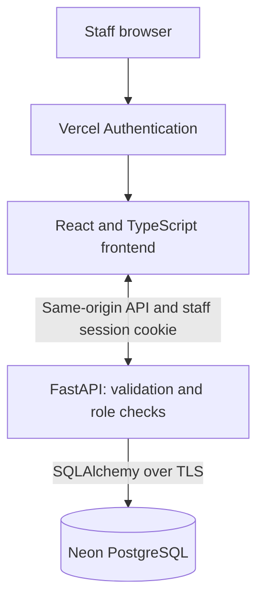
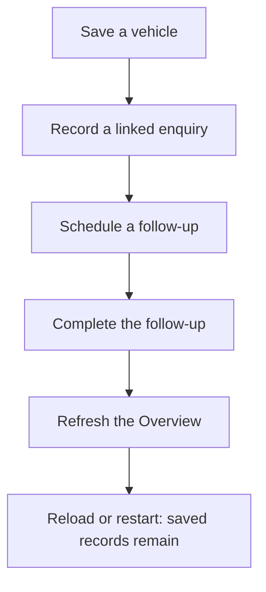

# Dealer Desk

By [Mohammed Sheikh-Noor](https://github.com/mohanoor-ai).

Dealer Desk is a web application for a single car dealership to manage vehicle stock, customer enquiries and follow-up tasks in one place. Staff sign in with role-based permissions, and records are saved in a shared database. The application uses React, TypeScript, FastAPI and PostgreSQL, with a development deployment on Vercel and Neon. Viewers can read; sales staff can update workflows; managers can inspect the audit history.

[Open the app](https://dealer-desk-dev.vercel.app/) · [Source code](https://github.com/mohanoor-ai/dealer-desk) · [Project overview](docs/project-overview.md)

The hosted development app currently requires Vercel authorization and an individually provisioned staff account. It is not yet an unrestricted public demo. Reviewers can also run it locally using the instructions below.

The aim is to keep vehicle availability, customer conversations and the next action together, instead of tracking them in separate lists.


Actual protected [Vercel deployment](https://dealer-desk-dev.vercel.app/#/overview), captured 24 October 2026 from application commit [b01d342](https://github.com/mohanoor-ai/dealer-desk/commit/b01d3427787b6abb70eae16ba8656ce104a2457b). The saved test workspace contains one sample vehicle, one open enquiry and no open follow-ups. Figures and empty states are unaltered. [Capture details and photo credit](docs/media/README.md).

## Current architecture



This shows the protected development deployment. The backend enforces permissions. Local development can use SQLite or Compose with PostgreSQL. Photos currently live in the database; R2 is planned. Temporary demos use isolated browser memory and do not write to this database. [Architecture and diagram status](docs/diagrams.md).

## Main staff journey



The real staff API/database journey has retained verification evidence. Browser-memory demos illustrate interaction only. [Verification record](docs/verification.md).

## Start with Docker
Install Docker Desktop on Windows (Linux containers) or Docker Engine with Compose on Linux. First setup downloads container images and dependencies and therefore needs internet.

Windows PowerShell: `./start.ps1`

Linux: `sh start.sh`

The script preserves an existing .env and database volume, builds and starts the app/database, and asks you to create the first manager account only if there are no users. Use a password of at least 12 characters. Open the browser address printed by the script. Subsequent runs preserve records and users. Never run `docker compose down -v` against data you need.

Create another account: `docker compose exec app python -m scripts.create_user alex --role sales`. Choose viewer, sales or manager. Passwords are entered interactively, never as command-line arguments.

## Local developer setup
Python 3.12+, uv and Node 24 are needed. From this folder:

```sh
uv sync --frozen
cd frontend
npm ci
npm run build
cd ..
uv run alembic upgrade head
uv run python -m scripts.create_user manager --role manager
uv run python start.py
```

Local development defaults to SQLite at data/dealer-v2.sqlite3. Set DATABASE_URL to use PostgreSQL. The frontend development server proxies /api to port 8090; start it with `npm run dev` inside frontend. The built interface is served by FastAPI.

## What works in the first milestone
- Login, logout, expiring/revocable sessions and server-enforced viewer/sales/manager roles.
- Create, read, search, filter and edit vehicles; vehicle status changes.
- Enquiries linked to stock, enquiry status changes, follow-up creation/completion/reopening.
- Persistent data and dashboard totals; shared views refresh every three seconds.
- Atomic revision checks reject conflicting edits; every material mutation records actor, record ID and revision in the audit table.
- Validated API inputs, centralized browser client and helpful empty/error states.

The API also supports archive/restore and manager audit queries; dedicated interface controls for these remain to be completed. Import/export, backup/restore, a public customer showroom, CI-gated delivery, full operations evidence and optional AI are not completed in this milestone. A protected Vercel development deployment is now verified below.

## Tests
After `uv sync --frozen` and `npm ci --prefix frontend`, run `uv run python -m scripts.verify` for backend tests, frontend tests, the production build and the limited source/history audit. The command stops if any check fails. Individual commands and database/browser/container boundaries are in [testing instructions](docs/testing.md). Actual results and limitations are in [verification](docs/verification.md).

## Access and privacy
This personal project is under development. Use sample records until the public-release checks are complete. No fixed user or password ships with the app. Keep .env, database files, backups and exports private. The private learning companion is a sibling deliverable and must not be added to this public source folder.

localhost / 127.0.0.1 means this computer. The Compose port binding deliberately limits access to this computer; LAN access needs deliberate binding/firewall changes and HTTPS/authentication review. A public cloud URL is different: anyone can reach the login screen.

## Deployment direction

The prepared Vercel build and protected development deployment procedure are documented in [docs/deployment-vercel.md](docs/deployment-vercel.md). The source/history review is in [docs/release-audit.md](docs/release-audit.md). Protected development hosting on Vercel with Neon is verified: https://dealer-desk-dev.vercel.app/ (owner Vercel login required, followed by a separately provisioned staff login). Cloudflare R2 photo storage remains planned; current images persist in the database.
Target: Vercel hosting with external PostgreSQL, subject to the completed free-tier and security review. Set COOKIE_SECURE=true for HTTPS. Vercel Hobby permits personal non-commercial use; a real business deployment needs suitable terms. This deployment is private to authorised Vercel users; no publicly accessible customer showroom is claimed.

## Engineering documentation and verification
Read docs/architecture.md for technology choices, docs/tasks.md for acceptance criteria and docs/verification.md for actual results. The original contract design is retained as docs/prior-api-design.yaml; openapi.yaml describes the current implementation. An in-app LLM is optional and is not required by the inspected current final rubric.

The [assessment evidence index](docs/assessment-evidence.md) maps the current implementation to all twelve official criteria, with explicit limitations and reviewer instructions.

Development responsibilities and review boundaries are described in [team](docs/team.md) and [process](docs/process.md). [AI use](docs/ai-use.md) records actual assistance and corrections; [security](docs/security.md) describes tool/data permissions and remaining risks. These documents do not claim independent reviews that did not happen.

Current and planned release/incident diagrams are in [docs/diagrams.md](docs/diagrams.md). The [local operations lab](docs/operations.md) demonstrates real OTLP collection, correlated request signals, an alert and a deterministic bounded repair. The [extension pack](docs/agent-extension-pack.md) includes a read-only MCP tool and enforced recovery policy. [Release controls](docs/release-recovery.md) describe the exact-commit CI gate, container recovery rehearsal and pending independent production setup. Private learning notes stay outside this repository.

## Public project tracking
Source: https://github.com/mohanoor-ai/dealer-desk

Acceptance criteria and remaining work: https://github.com/mohanoor-ai/dealer-desk/issues

Hosted checks: https://github.com/mohanoor-ai/dealer-desk/actions

The first hosted CI run passed for cd525a9. Protected development hosting is verified. CI-gated CD and public release remain pending; see docs/verification.md for exact evidence.

## Learning in public

Three articles are being prepared: scope and architecture; browser/API/database persistence; and testing and deployment. Drafts remain private until reviewed. Published article links will be collected in the [article index](docs/articles/README.md). These articles explain implementation decisions; assessment evidence remains in the verification record.
