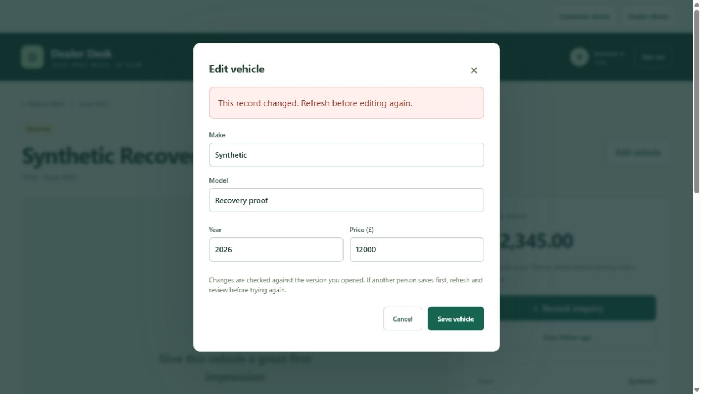

# From the browser to saved records

Mohammed Sheikh-Noor · 25 October 2026 · Prepared with AI assistance.

A stock tracker must retain work when the browser reloads. Dealer Desk's staff interface sends requests to a real API and database. A vehicle receives an identifier; an enquiry references that vehicle; a follow-up references the enquiry. Completing the follow-up changes its stored state and the Overview totals.

Server permissions are essential. A viewer can read, a sales account can change workflows, and a manager can inspect the audit history. Hiding an edit button helps the interface, but the API still has to reject an unauthorized request. Individual accounts use expiring, revocable server sessions.

Shared records also need conflict handling. A save includes the revision the editor opened. The database update matches both the record ID and that revision. If another save already changed the record, the API returns HTTP 409 and asks the editor to refresh. A successful change and its audit event commit together.

The manual two-session check used separate synthetic identities at 127.0.0.1 and localhost. Their browser cookies are separate while both origins reach the same local database. Session A opened a price edit; session B changed availability. A's stale save was rejected. After reload, the newer status and original price remained. A later status change appeared in A without a reload through normal polling.

Capture: 25 October 2026; isolated synthetic database; browser-a and browser-b test identities. The identities were signed out, disabled and their sessions revoked after the check. This is a manual independent-session check, not an automated cross-browser suite or a hosted production test.

The [database tests](../../tests/test_journey.py) separately exercise persistence across a new application instance and competing API edits. These layers answer different questions: frontend tests inspect interface logic, API/database tests inspect saved behaviour, and actual browser checks inspect the assembled workflow. The [verification record](../verification.md) retains their boundaries and results.

The overview now links each enquiry number directly to its saved record and distinguishes open enquiries from scheduled tasks. An enquiry without an incomplete task says “No next action scheduled”. Scheduling from that enquiry selects it automatically; completing a task leaves the enquiry open until staff explicitly changes its status. The README workflow collage shows actual local API/database steps with demonstration records, rather than a delivered customer message.
