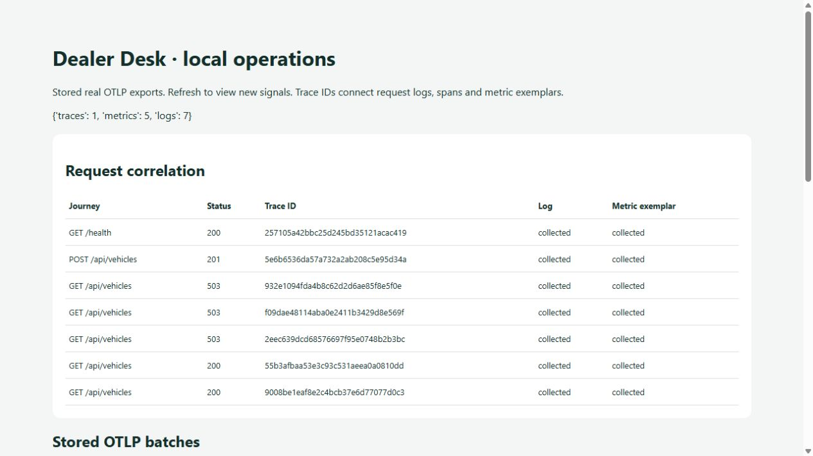

# Testing release and recovery in Dealer Desk

Mohammed Sheikh-Noor · 25 October 2026 · Prepared with AI assistance.

Dealer Desk now has one core verification command: `uv run python -m scripts.verify`. It runs backend tests, frontend tests, the production build and a limited source/history scan, stopping when a command fails. PostgreSQL and container checks remain separate CI steps. [Run instructions](../testing.md) explain each layer.

For implementation revision e51d7d7, [hosted CI passed](https://github.com/mohanoor-ai/dealer-desk/actions/runs/40174651942). It started the application and PostgreSQL through Compose, created a synthetic vehicle/enquiry/follow-up journey through HTTP, replaced the app container and verified the saved work. It also started the previous application image against the same disposable database, verified compatibility, restored the current image and verified again. This tests compatible image rollback; it does not undo a destructive database migration.

Vercel's build entry point now waits for successful trusted CI for the exact source revision. The hosted build log recorded that result before the frontend build, and the deployment became Ready. The protected health endpoint returned status ok. This avoids treating an independently green CI run as proof that deployment waited for it.

The operations lab uses real OpenTelemetry exports and a loopback collector with SQLite storage. Its UI joins request traces, structured logs and sampled metric exemplars. Request bodies, cookies, query strings and customer fields are excluded. This is a local development collector, not a production Grafana service. The capture was made on 25 October from the working-tree implementation based on 3298b5f; the [operations documentation](../operations.md) records that source limitation.

A controlled local fault made three authenticated stock reads return 503. That triggered an alert and a deterministic response agent. The agent could inspect and restore only a known renamed table in a fixed, explicitly marked rehearsal database. The same HTTP read then returned 200 and the vehicle remained saved. An independent restored backup matched the vehicle count and passed the integrity check. No hosted data was faulted, and no LLM diagnosis or unrestricted agent repair is claimed.

The owner-approved protected production copy now uses an isolated Neon branch and manual promotion after exact-revision CI. A planned cloud rollback between two compatible, security-fixed releases and forward restoration both passed health checks and preserved a completed demonstration follow-up. This was a recovery rehearsal, not a production incident; code rollback did not restore database contents. [Release/recovery details](../release-recovery.md) and the [evidence index](../assessment-evidence.md) retain that distinction.

AI Dev Tools Zoomcamp project progress · [DataTalks.Club](https://datatalks.club/) · [Alexey Grigorev](https://alexeygrigorev.com/)

#aidevtools #DataTalksClub #BuildInPublic #SoftwareEngineering
