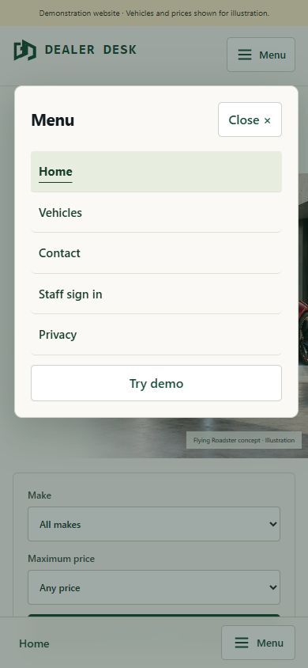

# Replacing scrolling menus on a phone

Mohammed Sheikh-Noor · 25 October 2026 · Prepared with AI assistance.

The desktop header has room for navigation links, while a narrow phone screen does not. Dealer Desk now replaces the top link row with a three-bar menu button at widths up to 760 pixels. A fixed bottom shortcut bar has a matching menu control.

Both buttons open the same vertical navigation dialog. Customer destinations include vehicles, contact and staff sign-in; the staff context provides overview, stock, enquiries and follow-ups. The current page is indicated inside the menu.

The implementation uses a native modal dialog. Close, Escape and selecting a link dismiss it, and focus returns to the trigger. Safe-area spacing and bottom page padding keep the fixed controls from covering the end of the content.

Manual local browser checks covered 320×640 and 390×844 layouts, route selection, Escape and demonstration navigation without horizontal overflow. Component tests cover menu behaviour. These checks do not establish a complete physical-device or cross-browser accessibility audit.

[Mobile navigation](../../frontend/src/MobileNavigation.tsx) · [Verification](../verification.md)

AI Dev Tools Zoomcamp project progress · [DataTalks.Club](https://datatalks.club/) · [Alexey Grigorev](https://alexeygrigorev.com/)

#aidevtools #DataTalksClub #BuildInPublic #SoftwareEngineering
