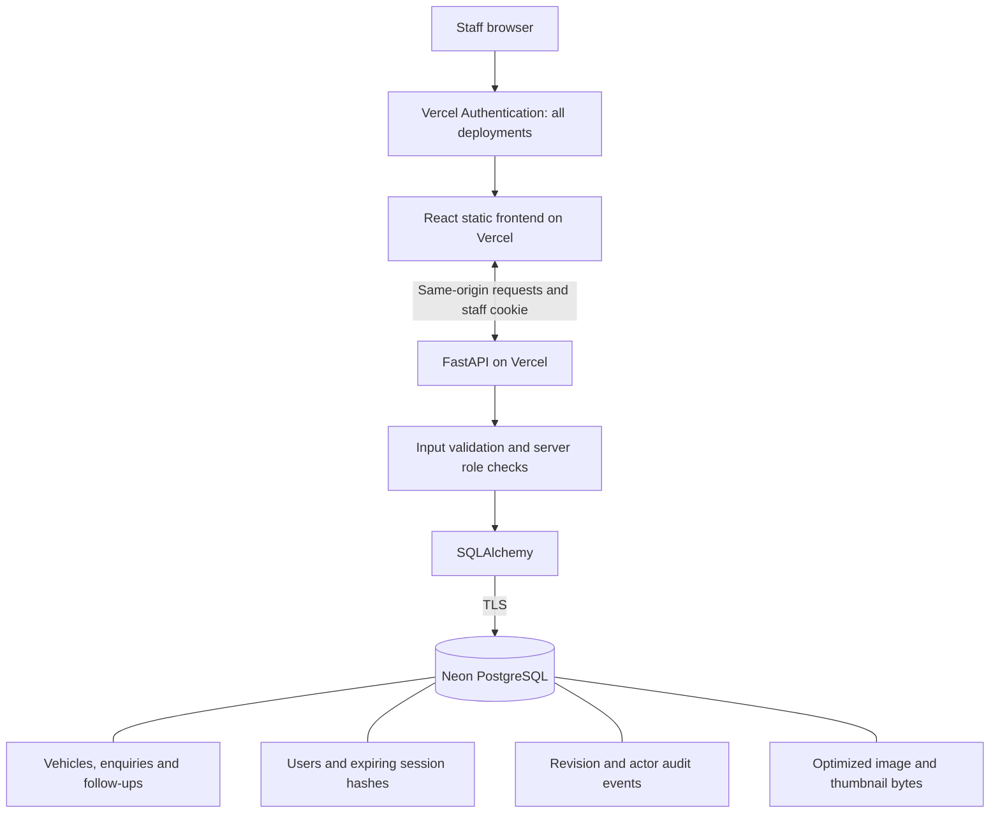
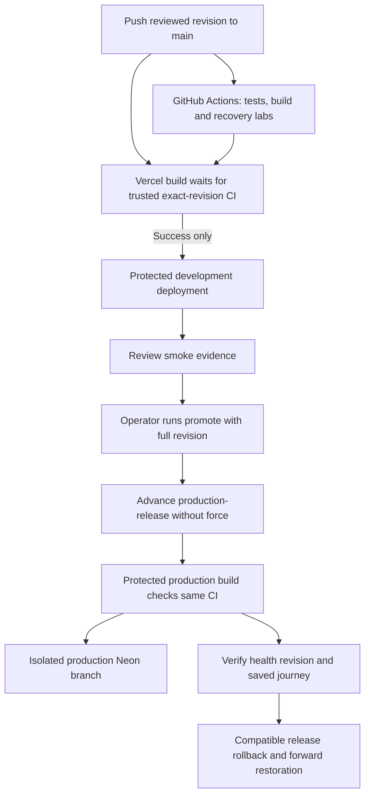
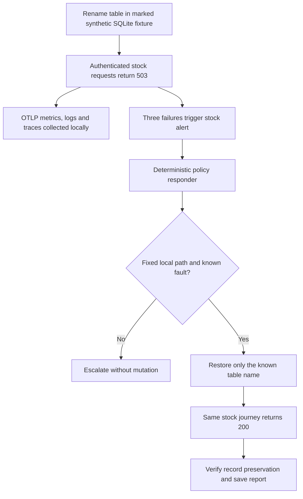

# System and workflow diagrams

Documentation checkpoint: 25 October 2026. Staff architecture remains the b01d342 baseline; release and operations diagrams include verified changes through 30dad17. Mermaid source is editable in this file and the README; no external diagram service is required to edit it.

## Current: hosted staff architecture



Vercel access and staff authentication are separate checks. Session cookies are HttpOnly/SameSite and secure on hosted HTTPS. They are not exposed to frontend JavaScript. The browser receives photo bytes through authenticated API routes. The database connection stays server-side.

The temporary Customer/Dealer demos intercept business operations inside the browser. They are separate from these persisted staff workflows; they create no authenticated guest account. Current local execution supports SQLite or Docker PostgreSQL. Cloudflare R2 is not implemented and is not drawn as an active dependency.

## Current: staff save and conflicting edits

```mermaid
sequenceDiagram
    actor Staff
    participant UI as React client
    participant API as FastAPI
    participant DB as Database
    Staff->>UI: Edit saved vehicle
    UI->>API: PATCH fields and opened revision
    API->>API: Validate session, role and fields
    API->>DB: Atomic update matching ID and revision
    alt Revision matches
        DB-->>API: One row updated
        API->>DB: Commit update and audit event
        API-->>UI: Saved record with new revision
        UI->>API: Refresh records
    else Another edit already changed the record
        DB-->>API: No matching update
        API-->>UI: 409 conflict; refresh and review
    end
```

The API tests cover permissions and competing edits. A manual independent-session conflict and polling check passed; see verification.md. This is not an automated cross-engine browser suite.

## Current: gated development and manual production



The cloud rollback/forward rehearsal between security-fixed 5fc3aae and 30dad17 passed. Vercel builds source; the separately tested Docker images are used for local/CI Compose. Code rollback does not undo database writes or schema migrations. An isolated SQLite restore lab is separate from a hosted Neon restore.

## Current local lab: bounded incident response



The responder has no hosted credentials, model-generated commands or arbitrary shell tool. Correlation UI, actual alert and repair are demonstrated in operations.md. Production telemetry and model-backed diagnosis are not claimed.

## Screenshot policy

Use real application/browser captures. State capture date, source commit, environment and whether data is fictional. Preserve error/empty states honestly rather than editing figures. Do not capture credentials, connection strings, personal customer data or account permission dialogs. Put CI, telemetry and incident screenshots with their relevant evidence once those checks exist.
