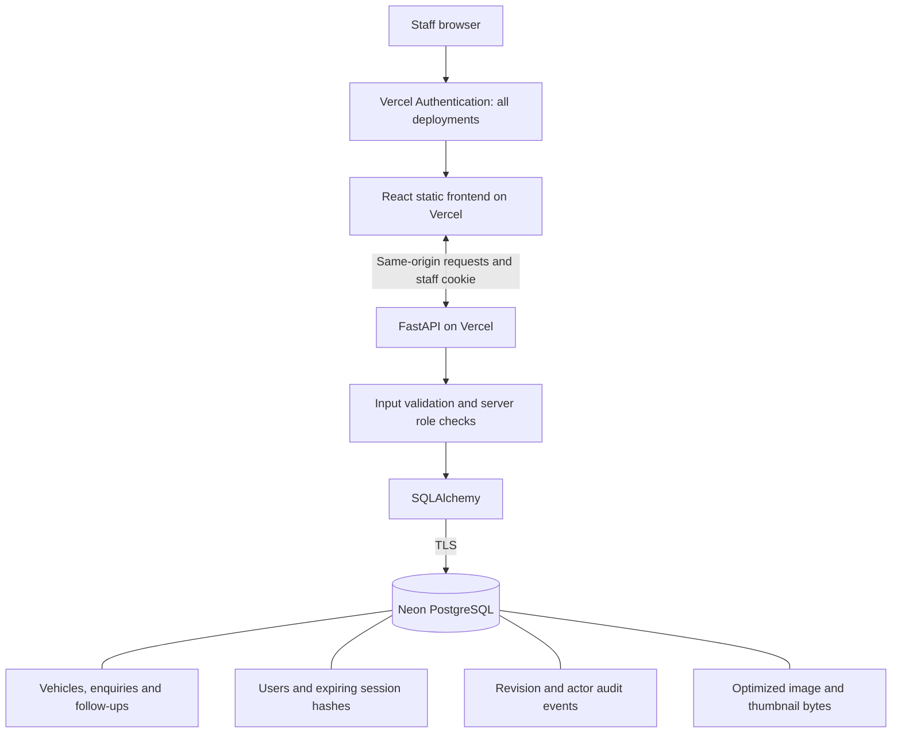
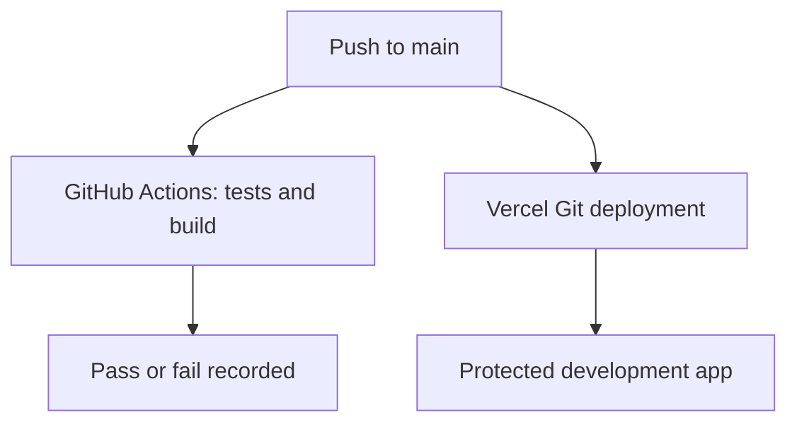
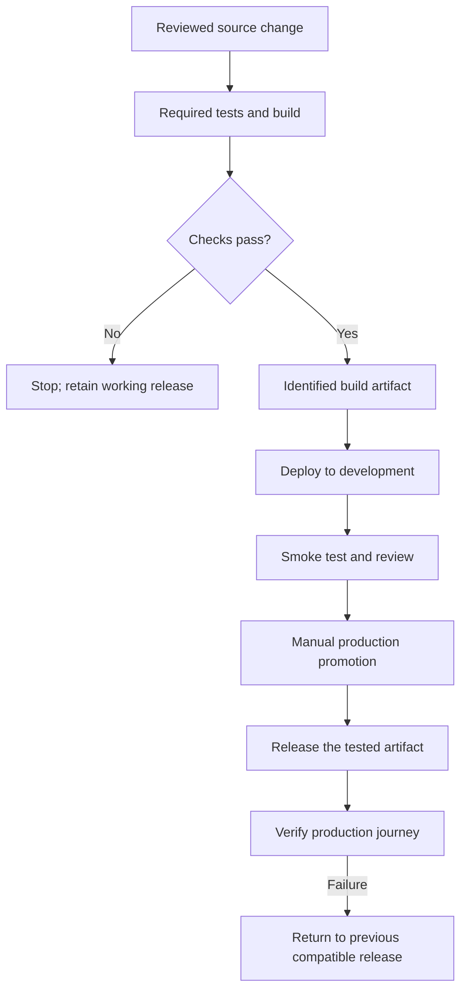
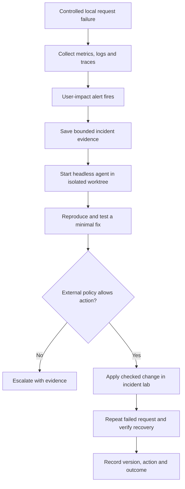

# System and workflow diagrams

Documentation checkpoint: 24 October 2026. Current diagrams describe application baseline b01d342. Planned diagrams describe work that has not yet been demonstrated. Mermaid source is editable in this file and the README; no external diagram service is required to edit it.

## Current: hosted staff architecture



Vercel access and staff authentication are separate checks. Session cookies are HttpOnly/SameSite and secure on hosted HTTPS. They are not exposed to frontend JavaScript. The browser receives photo bytes through authenticated API routes. The database connection stays server-side.

The temporary Customer/Dealer demos intercept business operations inside the browser. They are separate from these persisted staff workflows; they create no authenticated guest account. Current local execution supports SQLite or Docker PostgreSQL. Cloudflare R2 is not implemented and is not drawn as an active dependency.

## Current: staff save and conflicting edits

```mermaid
sequenceDiagram
    actor Staff
    participant UI as React client
    participant API as FastAPI
    participant DB as Database
    Staff->>UI: Edit saved vehicle
    UI->>API: PATCH fields and opened revision
    API->>API: Validate session, role and fields
    API->>DB: Atomic update matching ID and revision
    alt Revision matches
        DB-->>API: One row updated
        API->>DB: Commit update and audit event
        API-->>UI: Saved record with new revision
        UI->>API: Refresh records
    else Another edit already changed the record
        DB-->>API: No matching update
        API-->>UI: 409 conflict; refresh and review
    end
```

The API tests cover permissions and competing edits. A repeatable two-browser staff regression remains on the backlog; do not infer it from this sequence diagram.

## Current: delivery has two independent paths



The diagram above records the original independent triggers. A new gate in scripts/build_vercel.py now requires a successful trusted CI run for the exact commit before frontend build; see release-recovery.md and verification.md for hosted enforcement status. Manual production remains separate.

## Planned: gated release, promotion and rollback



Status: planned. Separate configuration/data, release gating, manual production promotion and exercised rollback are not complete. Code rollback does not restore database contents or undo migrations; backup/restore is a separate rehearsal. Implementation must fit the selected hosting platform rather than pretend Vercel deploys our Docker image.

## Current local lab: bounded incident response



Status: local OTLP collection, correlation UI, three-failure stock alert and deterministic fixed-action repair are demonstrated in operations.md. The responder has no hosted credentials or arbitrary command tool. Production telemetry and model-backed diagnosis are not claimed.

## Screenshot policy

Use real application/browser captures. State capture date, source commit, environment and whether data is fictional. Preserve error/empty states honestly rather than editing figures. Do not capture credentials, connection strings, personal customer data or account permission dialogs. Put CI, telemetry and incident screenshots with their relevant evidence once those checks exist.
